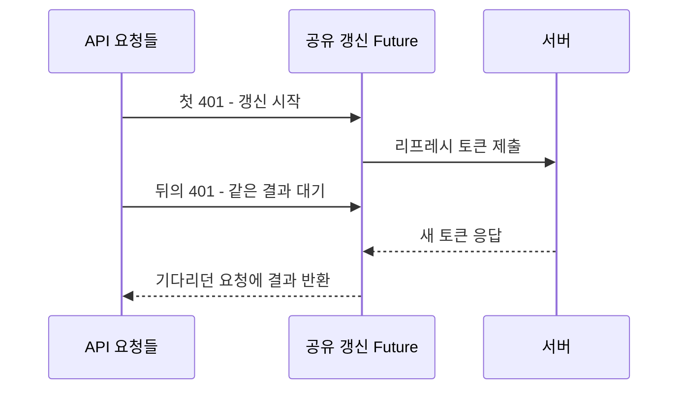

화면 하나에서 API 세 개가 동시에 401을 받았다. 각각 토큰을 갱신하면 될 것 같지만, 셋이 가진 리프레시 토큰은 같다.

VoiceLink 서버는 이 토큰을 한 번 쓰면 소비한다. 첫 갱신이 성공한 뒤 나머지가 같은 토큰을 내밀면 거절된다. **갱신을 열심히 할수록 실패가 늘어날 수 있다.** 실제 장애 사례가 아니라, 서버의 토큰 소비 코드와 Flutter의 동시 요청 처리를 따라가기 위한 상황이다.

## 세 요청이 기다릴 것은 하나의 갱신 결과

첫 요청 A가 갱신을 시작하면 B와 C는 진행 중인 `Future`를 기다린다. 새 토큰을 받은 뒤에는 각자 원래 API를 다시 보낸다. API 세 개를 차례로 실행할 필요는 없다.



`dio_provider.dart`에서 갱신 작업을 공유하는 부분이다.

```dart
if (pendingRefresh != null) {
  return pendingRefresh;
}
final future = _performRefresh(tokenStorage);
setPendingRefresh(future);
try {
  return await future;
} finally {
  setPendingRefresh(null);
}
```

묶는 기준은 **같은 화면이 아니라, 갱신이 아직 진행 중인지**다. A가 끝난 뒤 늦게 처리된 C의 401은 새 갱신을 시작할 수 있다. 이 변수도 해당 Dio 인스턴스 안에서만 공유하므로 다른 탭이나 기기까지 묶어주지는 않는다.

원래 API를 다시 보낼 때는 `retriedAfterRefresh=true`를 붙여 또 401을 받아도 갱신을 반복하지 않는다. `/auth/refresh` 자체도 갱신 대상에서 제외한다. “갱신하려고 다시 갱신”하는 반복을 막는 장치다.

## 옛 토큰은 지웠는데, 새 토큰 응답이 사라진다면

서버의 `RefreshTokenService.rotate`는 토큰 해시로 찾은 사용자 참조를 **읽으면서 지운다**.

```java
String userId = redisTemplate.opsForValue()
        .getAndDelete(key(normalize(refreshToken)));
if (!StringUtils.hasText(userId)) {
    throw new InvalidRefreshTokenException(
        "리프레시 토큰이 만료되었거나 유효하지 않습니다.");
}
```

조회와 삭제를 나눴다면 두 요청이 삭제 전에 같은 값을 읽을 수 있다. Redis의 `GETDEL`에 해당하는 이 호출은 한 요청만 그 값을 가져가게 한다. 이후 사용자 조회와 새 토큰 저장이 이어진다.

여기서 응답만 유실됐다고 가정해보자. `R0`·`R1`은 실제 자격 증명이 아닌 설명용 이름이다.

| 시점 | 앱의 토큰 | 서버의 토큰 |
| --- | --- | --- |
| 갱신 전 | R0 | R0 |
| 갱신 후 응답 유실 | R0 | R1 |
| R0로 다시 요청 | R0 | R0 거절, R1 유지 |

새 토큰을 만들기 전에도 실패할 수 있다. R0를 지운 뒤 사용자 조회나 R1 저장에서 오류가 나면 삭제는 되돌아오지 않는다. **명령 하나의 원자성이 갱신 전체의 원자성은 아니다.**

클라이언트는 갱신 요청이나 응답 저장에 실패하면 `null`을 반환하고, 원래 401 처리에서 세션 만료 신호를 올린다. 소비한 R0로 발급 결과를 다시 조회하는 복구 경로는 없다. 응답 저장도 액세스 토큰 → 리프레시 토큰 → 사용자 정보 순서라, 중간 쓰기 실패 시 일부만 바뀔 여지가 있다.

다음에 검증할 지점은 이 표의 두 번째 줄이다. **서버는 갱신을 끝냈는데 앱은 결과를 모르는 상황**을 만들어, 세션 만료 안내와 재로그인까지 이어지는지 확인해야 한다. 동시 401을 합치는 테스트만으로는 그 복구 흐름을 알 수 없다.

검토 범위: 2026년 10월 27일 VoiceLink `46282d5`의 토큰 서비스·만료 설정·Flutter 갱신 및 저장 코드·관련 테스트와 환경/업무 흐름 문서를 대조했다. Java 17에서 리프레시 서비스 테스트 4개가 통과했다. Redis 모의 객체로 토큰 소비·새 발급·없는 토큰 거절 등을 검사한 결과이며, 실제 Redis 경쟁·동시 401·응답 유실·부분 저장은 실행하지 않았다.

- [OAuth 2.0 Security Best Current Practice](https://www.rfc-editor.org/rfc/rfc9700.html)
- [Redis GETDEL](https://redis.io/docs/latest/commands/getdel/)
