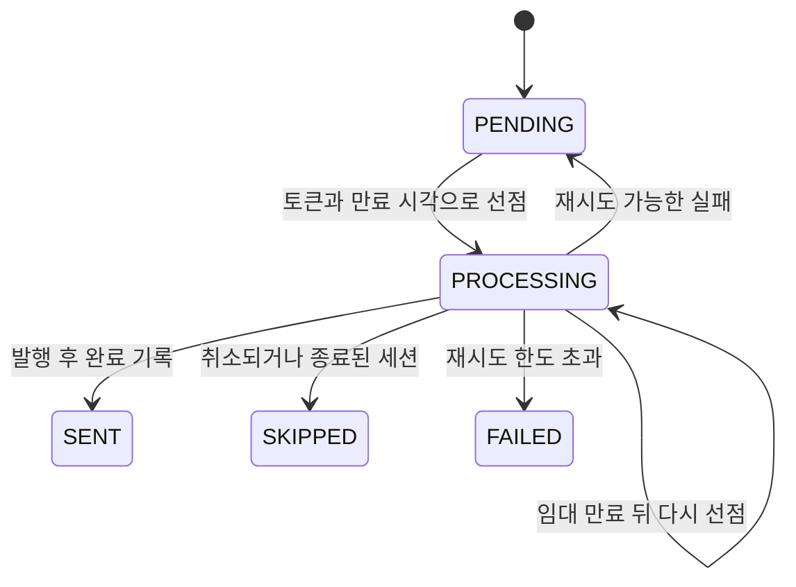

통화방은 저장됐는데 결과를 보내기 전에 서버가 꺼지면, 사용자는 계속 기다릴 수 있다. VoiceLink의 Outbox는 통화방과 “보낼 결과”를 같은 DB 트랜잭션에 남겨 이 틈을 다룬다.

변경 이력 `5091eba` 전에는 `publishPending`의 트랜잭션 안에서 행을 잠그고 외부 발행까지 했다. 이후에는 선점 트랜잭션과 발행을 나누고 임대 토큰을 붙였다. Java 17·Spring Boot 3.2.5 코드에서 무엇이 달라졌는지 행 하나로 따라가 보자. 아래 워커 A·B의 순서는 설명용이다.

## 1번 행을 기다리는 대신 2번 행 처리하기

A가 1번 행을 잡았는데 B도 같은 행을 기다린다면 워커를 늘린 의미가 줄어든다. 저장소는 지금 처리할 수 있는 미완료 행을 고르되, 잠긴 행은 건너뛴다.

```sql
SELECT *
FROM match_outbox
WHERE sent_at IS NULL
  AND status IN ('PENDING', 'PROCESSING')
  AND (next_attempt_at IS NULL OR next_attempt_at <= :now)
  AND (locked_until IS NULL OR locked_until <= :now)
ORDER BY COALESCE(next_attempt_at, created_at), id
LIMIT :limit
FOR UPDATE SKIP LOCKED
```

A가 1번을 잠근 동안 B는 다른 행으로 간다. 저장소 테스트는 A가 잠갔다는 신호를 받은 뒤 B를 시작한다. “우연히 다른 행을 골랐다”가 아니라 잠금이 유지된 상태에서 건너뛰는지 보는 것이다.

2026-10-10 PostgreSQL 16에서 이 동시 선점 테스트가 통과했다. 실행 조건은 글 끝에 남겼다.

대신 **오래된 행부터 엄격하게 완료되는 순서는 포기한다.** `ORDER BY`가 있어도 잠긴 행을 건너뛰기 때문이다.

고른 행에는 임대 토큰과 만료 시각을 적고 트랜잭션을 끝낸다. 외부 발행은 그 뒤에 실행한다. 네트워크 응답을 기다리는 동안 DB 잠금을 계속 잡지 않으려면, 잠금이 풀린 뒤에도 담당자를 구별할 방법이 필요하다.

## 잠금 다음에는 임대 토큰



설명용으로 A가 토큰 `lease-A`를 받고 일하다가 늦어졌다고 하자. 임대 만료 뒤 B가 `lease-B`로 같은 행을 가져가면 현재 담당자는 B다. A의 코드가 아직 실행 중이어도 담당자가 둘이 되는 것은 아니다.

완료·실패를 적는 `findByIdAndLeaseToken`은 행 ID와 토큰을 함께 찾고 쓰기 잠금을 건다. A의 옛 토큰으로는 B가 맡은 행을 갱신하지 않는다. 다만 **DB 갱신을 거절하는 것이 A의 실행이나 외부 메시지 발송까지 취소하지는 않는다.**

## 완료 도장을 못 찍은 메시지는 다시 나갈 수 있다

브로커가 메시지를 받은 직후, `SENT`를 적기 전에 프로세스가 끝났다고 하자. DB에는 미완료 행이 남아 다음 워커가 다시 보낸다. [소비 측은 같은 결과를 다시 받는다](https://so-dak.com/spring-boot-sseserver-sent-events%eb%a1%9c-%ec%8b%a4%ec%8b%9c%ea%b0%84-%eb%a7%a4%ec%b9%ad-%ec%83%81%ed%83%9c-%ed%91%b8%ec%8b%9c-%ea%b5%ac%ed%98%84%ed%95%98%ea%b8%b0/).

이 상태에서 중복을 무조건 피하려고 재발행을 막으면, 실제로 보내지 못한 결과도 포기할 수 있다. **다시 보낼 수 있게 하되, 받는 쪽에서 같은 결과를 중복 반영하지 않게 하는 설계**가 함께 필요하다.

유효한 결과는 캐시에 저장한 뒤 발행하고 `SENT`를 적는다. 실패하면 임대를 비우고 재시도 시각을 예약한다. 기본 설정은 실패를 기록할 때마다 `attempts`를 올려, 다섯 번째에 `FAILED`로 끝낸다.

예를 들어 `attempts=4`인 행을 발행한 직후 프로세스가 종료되면 DB 값은 여전히 4일 수 있다. 다음 워커는 임대 만료 뒤 또 보낼 수 있다. **다섯 번은 기록된 실패의 한도이지, 외부 발행 횟수의 상한이 아니다.** 이 순서는 설명용이며 발행 직후 강제 종료 시험은 아직 하지 않았다.

포기한 행은 오류와 함께 `FAILED`로 남기고 `sent_at`은 비워 둔다. 보내지 못한 결과에 완료 도장을 찍지 않는 것이다. 임대 서비스 테스트도 이 상태를 검사한다.

다음 장애 시험에서는 발행 직후 프로세스를 끊고, 같은 결과를 다시 받은 앱이 화면을 두 번 전환하지 않는지까지 볼 필요가 있다. 매칭 확정 코드에는 트랜잭션 안에서 로컬 대기를 완료하는 경로도 있으므로, Outbox 발행 경로만 시험해서 모든 응답이 커밋 뒤 전달된다고 판단할 수는 없다.

## 참고 자료

- [PostgreSQL SELECT 잠금 절](https://www.postgresql.org/docs/16/sql-select.html)
- [PostgreSQL 명시적 잠금](https://www.postgresql.org/docs/16/explicit-locking.html)
- [Spring 트랜잭션 경계](https://docs.spring.io/spring-framework/reference/data-access/transaction/declarative/annotations.html)

근거: 2026-10-12 VoiceLink `37109d5`의 매칭 확정·Outbox 코드와 설정, `docs/matching-call-lifecycle.md`를 대조했다. 본문의 구조 변경은 `5091eba` 이력에서 확인했다. 10월 10일 `1704b46`에서 Outbox 서비스 2개·임대 서비스 3개·발행기 3개 테스트가 통과했다. PostgreSQL 16 동시 선점 테스트는 Docker API 불일치로 건너뛰었으나 테스트 JVM에 API `1.40`을 지정한 재실행에서 1개가 통과했다. 발행 직후 강제 종료와 화면 중복 반영은 검증하지 않았다.

2026-11-01 재검토: VoiceLink `46282d5`의 관련 구현·설정·테스트·문서를 다시 대조했다. 위 테스트·실험 수치는 당시 기록이며 이번에 새로 측정한 값은 아니다.
