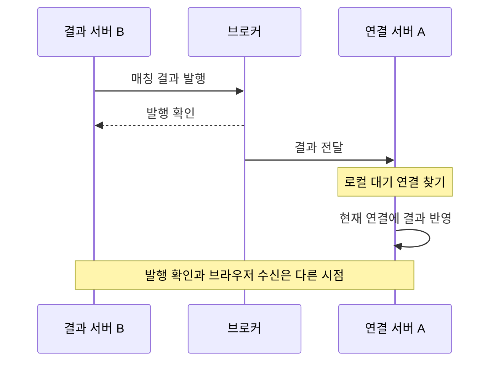

사용자는 서버 A에 연결돼 있는데 매칭은 서버 B에서 끝났다고 하자. B가 “상대 찾았어요”를 만들어도 A의 연결 객체에 바로 쓸 수는 없다. 그 객체는 A의 메모리에 있다.

**서버 사이로 보내야 할 것은 연결이 아니라 매칭 결과다.** VoiceLink의 Java 17·Spring Boot 3.2.5와 Flutter 코드를 따라, B의 결과가 A에 연결된 사용자에게 도착하는 과정을 읽어 봤다. 두 서버는 흐름을 설명하기 위한 예시다.



그림은 전달 단계의 설명이다. 브로커의 발행 확인과 A의 수신 중 어느 쪽이 먼저 완료되는지까지 정한 순서도는 아니다.

## 결과는 여러 서버에, 응답은 연결이 있는 서버에서

B는 사용자 ID와 매칭 결과를 RabbitMQ에 발행한다. `RabbitMqConfig`는 메시지를 연결된 큐 모두에 보내는 fanout exchange에 인스턴스별 큐를 붙인다. B가 사용자의 연결 위치를 알아내서 A만 골라 보내는 구조는 아니다.

각 서버의 수신기가 같은 결과를 받아도, 해당 사용자의 대기 요청을 가진 서버만 그 요청을 완료할 수 있다. A에서는 `MatchingQueue.handleMatchResultPayload()`가 사용자 ID로 로컬 대기를 찾고 `DeferredResult`에 결과를 넣는다. 여기까지도 아직 앱에 보낸 것은 아니다.

그 결과를 받은 `MatchStreamSession`이 HTTP 연결에 `event: match`를 쓴다. 상태가 `MATCHED`이면 스트림을 끝내고, `WAITING`이면 다음 대기를 예약한다. **브로커 메시지를 사용자의 응답으로 바꾸는 마지막 서버는 A다.**

앱은 Dio로 받은 스트림을 UTF-8과 줄 단위로 풀어 `MatchSseParser`에 넘긴다. 파서는 `event: match`의 JSON을 매칭 결과로 바꾸고 `: ping` 같은 주석은 건너뛴다. 연결이 열렸다는 사실만으로는 부족하고, 이 해석까지 이어져야 앱이 결과를 사용할 수 있다.

## 브로커가 받았다는 답만으로는 부족하다

B가 발행 확인인 ack를 받았으면 끝일까? 받을 큐가 없어 메시지가 반환되는 경우를 따로 봐야 한다. 실제 발행 코드의 검사 부분이다.

```java
if (confirm == null || !confirm.isAck()) {
    String reason = confirm == null ? "missing confirm" : confirm.getReason();
    throw new IllegalStateException(
            "RabbitMQ publish not acknowledged: " + reason);
}
if (correlationData.getReturned() != null) {
    throw new IllegalStateException(
            "RabbitMQ publish returned: "
                    + correlationData.getReturned().getReplyText());
}
```

`RabbitMqMatchResultPublisher`는 기본 5초 동안 confirm을 기다린 뒤, ack 여부와 반환 메시지 유무를 확인한다. ack라도 반환됐다면 실패다. `publishRejectsReturnedMessageEvenWhenAcknowledged` 테스트도 이 조합을 넣어 거절되는지 검사한다.

발행이 실패하면 `MatchResultRealtimePublisher`가 Redis Pub/Sub로 한 번 더 시도한다. RabbitMQ 발행이 성공하면 Redis로 다시 보내지 않고, 둘 다 실패하면 예외를 올린다. 받을 곳까지 결과를 보내려는 대체 경로다.

다만 메시지는 전달됐는데 confirm만 유실됐다면, Redis로 보낸 결과까지 두 번 도착할 수 있다. **대체 경로가 있다는 말은 정확히 한 번 도착한다는 뜻이 아니다.** 이 발행 검사가 확인한 것은 브로커 발행까지다. A의 로컬 대기 완료와 HTTP 전송 여부까지 알려 주지는 않는다.

## A에 받을 연결이 없다면

사용자가 잠깐 나간 사이 결과가 도착할 수도 있다. 현재 RabbitMQ 큐는 비영속·자동 삭제 설정이고 Redis Pub/Sub도 놓친 메시지를 보관해 재생하지 않는다. 실시간 알림만으로 재접속까지 해결할 수는 없다.

그래서 [Outbox 워커](https://so-dak.com/%eb%b6%84%ec%82%b0-%ec%8b%9c%ec%8a%a4%ed%85%9c-%ec%a0%95%ed%95%a9%ec%84%b1-%eb%b3%b4%ec%9e%a5-transactional-outbox-pattern%ec%9c%bc%eb%a1%9c-%eb%a7%a4%ec%b9%ad-%ec%9d%b4%eb%b2%a4%ed%8a%b8-%eb%b0%9c/)는 발행 전에 사용자별 결과를 Redis 캐시에 남긴다. 이후 매칭 조회에서는 활성 세션을 확인하고, 필요한 경우 결과 캐시도 조회한다. 알림을 받는 길과 이미 만들어진 결과를 다시 찾는 길을 함께 둔 것이다.

대기 중 알림을 놓친 경우에도 조회 기회가 있다. 현재 서버는 기본 25초가 지나면 해당 대기 회차를 `WAITING`으로 완료하고 5초 뒤 다시 조회하도록 예약한다. 이는 코드의 예약 간격이며 실제 화면의 복구 시간을 측정한 값은 아니다.

캐시는 기본 55초 뒤 만료된다. `claimMatchResult()`의 읽기와 삭제도 별도 Redis 호출이므로 한 번만 가져간다는 보장은 없다. 실시간 수신으로 로컬 대기를 완료했을 때도 캐시를 지우는데, **이 삭제는 앱의 화면 반영을 확인한 뒤 하는 처리가 아니다.** 결과를 다시 찾을 자리는 있지만, 모든 끊김을 복구한다고 말할 수는 없다.

B가 가진 것은 매칭 결과이고 A가 가진 것은 사용자의 연결이다. 둘을 이어 주는 것은 결과 전달과 A의 로컬 대기 처리다. SSE 객체를 다른 서버로 옮기는 대신, **연결이 있는 자리에서 결과를 응답으로 바꾼다.**

## 참고 자료

- [SSE 표준](https://html.spec.whatwg.org/multipage/server-sent-events.html)
- [RabbitMQ 발행 확인과 소비 확인](https://www.rabbitmq.com/docs/confirms)
- [Redis Pub/Sub 전달 특성](https://redis.io/docs/latest/develop/pubsub/)

2026-10-12 VoiceLink `37109d5`의 브로커 설정·발행기·수신기, `MatchingQueue`, `MatchStreamSession`, 결과 캐시·Outbox 코드, Flutter 파서와 `docs/redis-matching-flow.md`를 대조했다. Linux·Java 17에서 발행·수신·재조회·캐시 관련 테스트 31개가 통과했다. 대역과 가상 시간을 사용하는 검증이며, 브로커를 실제로 끊는 다중 서버 시험이나 앱 화면의 중복 전환 확인은 포함하지 않았다.
