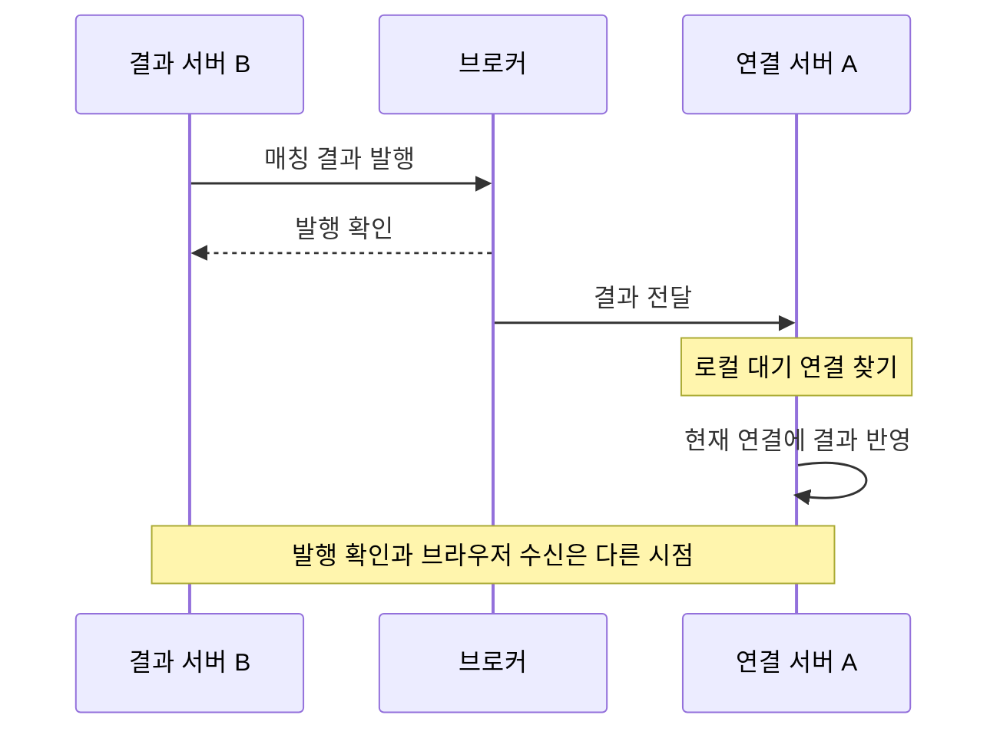

사용자는 서버 A에 연결돼 있는데 매칭은 서버 B에서 끝났다고 하자. B가 “상대 찾았어요”를 만들어도 A의 연결 객체에 바로 쓸 수는 없다. 그 객체는 A의 메모리에 있다.

**서버 사이로 보내야 할 것은 매칭 결과다.** VoiceLink의 Java 17·Spring Boot 3.2.5 구현을 두 서버 예시로 따라가 보자.

전달 단계를 설명한 그림이다. 발행 확인과 A의 수신 중 어느 쪽이 먼저 끝나는지까지 정한 순서는 아니다.

## 결과는 여러 서버에, 응답은 연결이 있는 서버에서

B는 사용자 ID와 매칭 결과를 RabbitMQ에 보낸다. 각 서버의 큐가 같은 결과를 받는 fanout 방식이다. B가 “이 사용자는 A에 있네” 하고 목적지를 고를 필요는 없다.

A는 사용자 ID로 자기 메모리의 대기 요청을 찾아 결과를 넣는다. 다른 서버에도 알림은 도착하지만, 그 사용자의 대기 요청이 없으면 완료할 요청도 없다. **같은 소식을 받아도 응답할 연결은 A가 가지고 있다.**

A의 `MatchStreamSession`은 이 결과를 SSE의 `event: match`로 쓴다. 상태가 `MATCHED`이면 스트림을 끝내고, `WAITING`이면 다음 대기를 예약한다.

앱의 `MatchSseParser`가 그 이벤트의 JSON을 읽으면 매칭 결과를 사용할 수 있다. `: ping`은 연결을 유지하기 위한 주석이라 건너뛴다. 여기까지가 B에서 만든 결과가 앱에 도착하는 길이다.

## 중간에 끊겼다면

RabbitMQ 발행이 실패하면 Redis Pub/Sub로 한 번 더 시도하고, 둘 다 실패하면 예외를 올린다. 다만 첫 메시지는 전달됐는데 발행 확인만 유실된 경우에는 결과가 중복 도착할 수 있다. **브로커의 발행 확인은 앱의 수신 확인도 아니다.**

사용자가 연결을 끊은 사이 알림이 도착할 수도 있다. 그래서 [Outbox 워커](https://so-dak.com/%eb%b6%84%ec%82%b0-%ec%8b%9c%ec%8a%a4%ed%85%9c-%ec%a0%95%ed%95%a9%ec%84%b1-%eb%b3%b4%ec%9e%a5-transactional-outbox-pattern%ec%9c%bc%eb%a1%9c-%eb%a7%a4%ec%b9%ad-%ec%9d%b4%eb%b2%a4%ed%8a%b8-%eb%b0%9c/)는 발행 전에 결과를 Redis 캐시에도 남긴다. 이후 매칭 조회는 활성 세션을 먼저 확인하고, 필요하면 결과 캐시를 읽는다. 알림을 놓쳤을 때 이미 만들어진 결과를 다시 찾는 길이다.

예를 들어 알림을 놓친 뒤 다시 조회했는데 결과 캐시는 비어 있다고 하자. 설명용 상황이다. `MatchService.connect()`는 곧바로 새 상대를 찾지 않고, **다시 사용할 수 있는 기존 세션부터 확인한다.** 그 세션이 있으면 응답을 다시 만든다. 활성 세션을 찾지 못했을 때 결과 캐시를 확인하고, 캐시의 세션도 종료되지 않았는지 검사한다.

캐시는 기본 55초 뒤 만료되고 서버가 대기 요청을 완료하면서 지울 수도 있다. 앱이 읽을 때까지 보관되는 우편함은 아니다. 이 때문에 재접속을 살펴볼 때는 브로커 재전송뿐 아니라 **이미 만든 통화방을 다시 찾는 흐름**까지 따라가야 한다. 여기까지 있어도 모든 끊김의 복구나 한 번만 전달되는 것까지 보장하지는 않는다.

## 참고 자료

- [SSE 표준](https://html.spec.whatwg.org/multipage/server-sent-events.html)
- [RabbitMQ 발행 확인과 소비 확인](https://www.rabbitmq.com/docs/confirms)
- [Redis Pub/Sub 전달 특성](https://redis.io/docs/latest/develop/pubsub/)

근거: 2026-10-15 VoiceLink `37109d5`의 발행·수신·SSE·캐시 코드, `MatchService`·활성 세션 조회와 관련 테스트, Flutter 파서와 매칭 흐름 문서를 대조했다. 10월 12일 Linux·Java 17에서 통과한 관련 테스트 31개는 대역·가상 시간 검증이며 실제 다중 서버 장애나 앱 화면의 중복 전환 시험은 포함하지 않았다.
