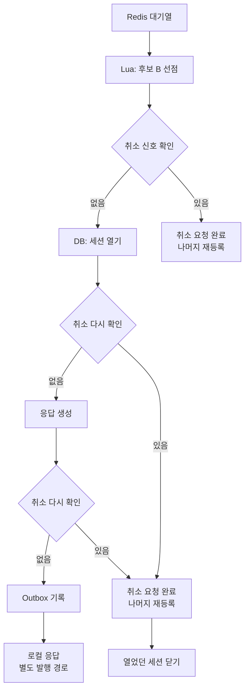

대기열의 B를 A와 C가 동시에 읽었다고 하자. “B를 찾았다”만으로 둘 다 반환하면 같은 사람에게 통화 상대가 두 명 생길 수 있다.

VoiceLink의 Java 17·Spring Boot 3.2.5 매칭 코드는 후보를 찾은 사실보다 **이번 요청이 대기열에서 후보를 제거했는지**를 본다. Lua가 먼저 해결하는 것은 이 선점 경쟁이다.

## 읽기와 제거 사이를 묶는다

후보를 읽고 나중에 별도 요청으로 지우면 그 사이에 다른 요청이 끼어들 수 있다. Lua 안에서 제거 결과와 유효한 대기 표시를 함께 확인한다. 후보 순회·입력 처리를 줄인 실제 발췌다.

```lua
local removed = redis.call('ZREM', waitingZsetKey, candidateId)
if removed == 1 then
    local presenceKey = presencePrefix .. candidateId
    if redis.call('EXISTS', presenceKey) == 1 then
        redis.call('DEL', presenceKey)
        return candidateId
    end
end
```

`ZREM`이 1일 때만 이번 요청이 후보를 제거한 것이다. 이어 presence 키가 남아 있는 후보를 반환한다. Lua 실행 도중 다른 명령이 끼어들지 않으므로 이 판단을 한 덩어리로 할 수 있다.

## 같은 후보에 두 요청을 보내봤다

2026년 10월 9일, Redis 8.2.0을 별도 로컬 인스턴스로 띄우고 VoiceLink `b159c1d`의 `find_opponent.lua`를 수정 없이 실행했다. 서비스 DB나 실제 사용자 없이 합성 대기열만 썼다.

매번 후보 B(ID 2) 한 명과 60초 presence를 넣었다. 별도 연결 두 개가 각각 A(ID 1), C(ID 3)로 요청하도록 스레드 배리어에서 출발을 맞췄고, 각 요청의 탐색 수는 10이었다. 대기열을 초기화하며 100회 반복했다.

```text
실험 회차: 100
B를 정확히 한 요청만 반환한 회차: 100
두 요청이 함께 B를 반환한 회차: 0
```

각 회차에서 두 반환값은 `2`와 `nil`이었다. 그 뒤 대기열 크기와 B의 presence가 모두 0인지도 확인했다. 이는 이 입력에서 Lua의 후보 선점 결과를 관찰한 값이다. 통화 성공률이나 운영 부하 테스트 수치로 해석하지 않는다.

## nil을 받아도 사람이 남아 있었다

이번에는 presence가 없는 ID 10·11을 앞에, 살아 있는 ID 12를 뒤에 넣었다. 스캔 수를 2로 제한하니 결과가 달라졌다.

| 실제 호출 | 반환값 | 남은 상태 |
| --- | --- | --- |
| 첫 탐색, scan=2 | `nil` | 오래된 후보 둘은 제거, 살아 있는 12는 대기 |
| 같은 조건의 두 번째 탐색 | `12` | 살아 있는 후보 선점 |

첫 요청은 자신이 본 두 후보를 정리했을 뿐, 세 번째 사람까지 본 것이 아니다. **빈 반환값은 이번 배치에서 유효한 상대를 못 찾았다는 뜻이다.** 대기열 전체가 비었다는 뜻으로 바꾸면 이 경우를 설명할 수 없다.

스크립트가 오래 돌면 다른 Redis 요청도 기다리므로 탐색 수를 제한할 이유는 있다. 다만 제한으로 빈 결과가 나왔을 때 다시 탐색할 흐름도 함께 봐야 한다. presence의 TTL도 실제 접속 종료를 즉시 알려 주는 센서는 아니다.

## 후보를 꺼낸 다음부터는 다른 문제

B를 선점한 직후 A가 취소했다고 해보자. B는 이미 대기열에서 빠졌다. 통화방 저장만 롤백하면 B는 줄에서도 빠지고 방에도 못 들어간다. 이름표는 받아 왔는데 갈 곳이 없는 셈이다.

**DB 롤백은 Redis 대기열을 되돌리지 않는다.** 그래서 매칭 확정 코드에는 취소한 사람과 계속 기다리는 사람을 구분하는 처리가 필요하다.



`MatchFinalizer`는 세션 생성 전후와 응답 생성 뒤에 취소 신호를 확인한다. 처음 확인할 때 A가 기다리고 있었어도, DB에 세션을 저장하는 사이 취소할 수 있기 때문이다. 한 번 확인한 값을 끝까지 믿을 수 없다. 세션을 연 다음의 처리는 이렇다.

```java
if (requeueOnCancelSignal(clientA, clientB)) {
    callSessionCommandPort.closeSessionSilently(sessionId, LocalDateTime.now());
    return;
}
```

`requeueOnCancelSignal`은 취소한 A의 요청을 완료하고 기다리던 B를 재등록한다. 그 뒤 열린 세션을 닫는다. 그림은 이 호출 순서이며 Redis 재등록과 DB 종료가 한 번에 커밋된다는 뜻은 아니다.

`MatchFinalizerTest`의 저장 후 취소 사례는 A의 취소 조회가 처음에는 `false`, 다음에는 `true`를 반환하게 만든다. 그때 B를 재등록하고 열린 세션을 닫으며, Outbox에 매칭 결과를 넣지 않는지 검사한다. 저장 전후와 응답 생성 뒤를 나눈 대역 테스트이며, 모든 시점의 취소나 실제 Redis·DB 복구를 증명하는 시험은 아니다.

**복구한다고 두 사람을 모두 줄에 세울 수는 없다.** A는 그만 기다리겠다고 했고, B는 계속 기다리는 중이다. 되돌릴 상태도 그 차이를 따라야 한다.

## 참고 자료

- [Redis Lua 실행 모델](https://redis.io/docs/latest/develop/programmability/eval-intro/)
- [Redis ZRANGE](https://redis.io/docs/latest/commands/zrange/)
- [Redis ZREM](https://redis.io/docs/latest/commands/zrem/)
- [Spring Data Redis 스크립팅](https://docs.spring.io/spring-data/redis/reference/redis/scripting.html)

근거: 2026-10-15 VoiceLink `37109d5`의 Lua·Redis 저장소·매칭 확정 코드·테스트와 매칭 흐름 문서를 재확인했다. 수치는 10월 9일 단일 Redis 인스턴스의 실험 기록이다. 재등록 도중 Redis 장애·프로세스 종료가 발생하는 경우와 Redis Cluster는 이 글의 검증 범위에 포함하지 않았다.
