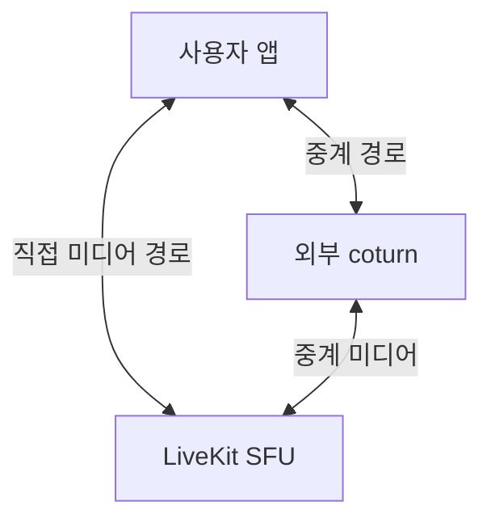

VoiceLink의 `livekit.yaml`에는 `turn.enabled: false`가 있다. 그런데 같은 파일 위쪽에는 외부 TURN 서버가 등록돼 있고, 저장소에는 coturn 설정도 남아 있다.

꺼 둔 기능의 설정을 안 지운 걸까? **두 설정이 가리키는 TURN이 다르다.**

## 끈 것은 LiveKit 안의 TURN

다음은 실제 설정에서 외부 서버 항목 하나와 내장 TURN 설정만 남긴 발췌다. 주소는 예시로 바꾸고 인증 정보는 생략했다. 그대로 실행할 완성 설정은 아니다.

```yaml
rtc:
  turn_servers:
    - host: turn.example.invalid
      port: 3478
      protocol: udp
      # 인증 정보 생략

turn:
  enabled: false
```

아래의 `turn.enabled`는 **LiveKit에 내장된 TURN 서버를 실행할지** 정한다. 위의 `rtc.turn_servers`는 **클라이언트가 사용할 외부 TURN 서버 목록**이다. LiveKit의 [공식 설정 예제](https://github.com/livekit/livekit/blob/master/config-sample.yaml)도 두 항목을 따로 둔다.

VoiceLink는 외부 목록에 UDP·TCP·TLS 접속을 등록했다. Compose는 이 `livekit.yaml`을 LiveKit 컨테이너에 마운트하고 `--config`로 읽게 한다. 파일만 따로 남아 있는 상태는 아니다.

반면 coturn은 Compose 서비스로 정의돼 있지 않다. 프로젝트 문서는 호스트에 별도 설치하는 방식으로 설명한다. **내장 서버를 끄고, 바깥의 coturn을 사용하도록 연결한 구성**이다.

## coturn은 통화 상대가 아니다

TURN은 직접 연결이 어려운 네트워크에서 미디어를 중계할 경로를 제공한다. 여기서 직접 연결의 상대는 다른 사용자가 아니라 LiveKit SFU, 즉 통화 미디어를 전달하는 서버다. 사용자끼리 직접 연결하는 P2P 그림으로 읽으면 경로가 달라진다.



두 경로를 구분한 설명용 그림이다. 매 통화가 두 경로를 동시에 쓰거나 반드시 coturn을 지난다는 뜻은 아니다. [LiveKit 배포 문서](https://docs.livekit.io/transport/self-hosting/deployment/)도 제한된 네트워크의 연결성을 보완하는 방법으로 TURN을 설명한다.

## 설정을 고칠 곳도 나뉜다

이 구조에서는 LiveKit을 재시작하는 것과 호스트의 coturn을 재시작하는 것이 별개다. `rtc.turn_servers`를 바꾸는 일은 클라이언트에 알려 줄 접속 정보를 바꾸는 것이지, coturn의 리스너를 새로 여는 작업이 아니다.

프로젝트 문서의 TLS 경로가 좋은 예다. 클라이언트는 외부 **443**으로 접속하지만 coturn은 **5349**에서 받도록 설명돼 있다. 그 사이에서 Nginx가 TLS 요청의 서버 이름을 보고 coturn으로 보낸다. 숫자가 다르다고 곧바로 오타는 아니다. 대신 클라이언트에 알린 포트, Nginx 전달 대상, coturn 리스너가 한 경로로 이어지는지 봐야 한다.

내장 TURN의 스위치 하나로 이 세 곳을 바꿀 수는 없다. 설정을 읽을 때도 **접속 정보를 알려 주는 쪽과 실제 중계 서버를 실행하는 쪽**을 나누면, 어디를 수정해야 하는지가 보인다. 후보가 있다는 사실과 실제 경로 선택의 차이는 [별도 로컬 실험](https://so-dak.com/turn-relay-verification/)에서 확인했다.

## 확인한 근거

2026-10-15 VoiceLink `37109d5`의 `livekit.yaml`, `docker-compose.yml`, `infra/coturn/turnserver.conf`, coturn 구축·서버 아키텍처 문서를 대조했다. 현재 구성을 해석한 글이며, 외부 coturn을 선택한 당시의 대안 비교를 재구성한 회고는 아니다. 문서의 TLS 경로를 호스트에서 다시 시험하지는 않았다. LiveKit 이미지 태그는 `latest`라 실행 서버 버전도 이 설정만으로 특정하지 않았다.
