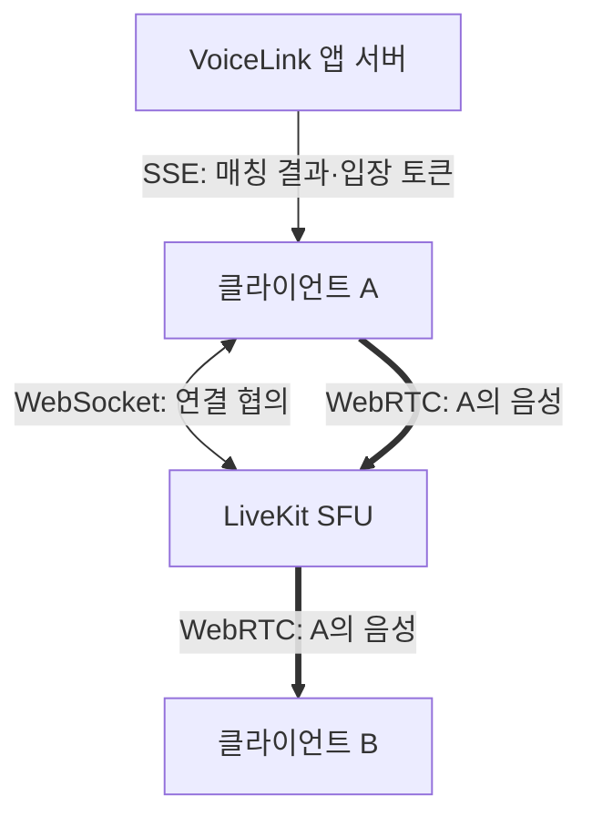

브라우저에서 LiveKit WebSocket이 열렸는데 상대 목소리는 안 들린다고 하자. 설명용 상황이다. 연결 하나가 성공했으니 통신은 끝났다고 생각하기 쉽지만, **연결을 협의하는 길과 목소리가 오가는 길은 다르다.**

VoiceLink의 Flutter 클라이언트는 `livekit_client` 2.5.4를 쓴다. 앱 서버에서 매칭 결과를 받는 것부터 상대 음성을 듣기까지, 길을 나눠 보자.

## 매칭 결과에는 목소리가 들어 있지 않다

앱의 API와 SSE는 매칭 요청·결과, 통화 종료·연장 같은 업무 정보를 주고받는다. 매칭 결과에는 세션 ID, LiveKit 접속 주소와 입장 토큰이 담긴다. 서버의 `LiveKitTokenService`는 그 세션의 방에 들어가 트랙을 발행하고 구독할 권한을 토큰에 넣는다. 입장권을 받았다고 대화까지 나눈 것은 아니다.

그다음 SDK가 LiveKit에 연결한다. LiveKit의 signaling은 WebSocket으로 방 정보와 미디어 연결 협상 정보를 교환한다. 음성 트랙은 별도의 WebRTC 연결로 LiveKit SFU에 보내고, SFU가 구독한 상대에게 전달한다. 앱의 SSE가 이 signaling을 대신하지 않는다.

아래는 역할을 구분한 그림이다. 음성은 A가 말하는 방향만 그렸고, B도 같은 방식으로 LiveKit에 연결한다. TURN을 거치는 중계 구간은 생략했다.

**두 사람의 통화여도 A와 B가 직접 음성을 교환하는 P2P 그림은 아니다.** VoiceLink에서는 각 클라이언트가 LiveKit SFU와 미디어를 주고받는다. 저장소의 `livekit.yaml`도 서버 포트와 `rtc`의 TCP·UDP 포트 설정을 나눈다.

## ‘연결됨’ 다음에 확인할 것

`LiveKitService.connect()`는 `room.connect()`를 기다린 뒤 마이크 트랙을 만들고 `publishAudioTrack()`을 호출한다. 이후 오디오 재생을 시도한다. WebSocket이 열렸다는 관찰 하나에는 이 뒤의 과정이 담기지 않는다.

따라서 앞의 무음 상황에서는 먼저 **어디까지 성공했는지**를 나눈다. 마이크 트랙이 만들어지고 발행됐는지, 상대가 트랙을 구독했는지, 수신 통계가 늘어나는지, 마지막으로 재생이 시작됐는지다. 토큰 발급 응답만 붙잡고 있어서는 목소리가 어디서 멈췄는지 찾기 어렵다.

수신 통계가 없다는 이유만으로 TURN 장애를 확정할 수도 없다. 발행 전부터 멈췄을 수 있기 때문이다. 반대로 패킷이 들어와도 브라우저에서 소리가 재생됐다는 증명은 아니다. [마이크 권한과 연결 수명](https://so-dak.com/webrtc-livekit-%ec%97%b0%eb%8f%99-%ed%9a%8c%ea%b3%a0-%ea%b7%b8%eb%83%a5-%ec%98%a4%ed%94%88%ec%86%8c%ec%8a%a4-%ec%84%9c%eb%b2%84-%eb%9d%84%ec%9a%b0%eb%a9%b4-%eb%90%98%eb%8a%94-%ea%b1%b0-%ec%95%84/)을 따로 보는 이유도 여기에 있다. 중계 서버가 붙는 위치는 [외부 TURN 구성](https://so-dak.com/livekit-external-turn/)에서 이어서 살펴봤다.

## 참고 자료

- [LiveKit Client Protocol: WebSocket과 WebRTC 연결](https://docs.livekit.io/reference/internals/client-protocol/)
- [LiveKit SFU: 발행자에서 구독자로 미디어 전달](https://docs.livekit.io/reference/internals/livekit-sfu/)

근거: 2026-10-13 VoiceLink `37109d5`의 `MatchResponseFactory`, `LiveKitTokenService`, Flutter `match_api.dart`·`livekit_service.dart`, `livekit.yaml`과 `docs/matching-call-lifecycle.md`를 대조했다. 연결 테스트는 방과 마이크 트랙을 대역으로 바꾸므로 실제 미디어 전달의 근거로 쓰지 않았다. 이 글은 코드와 프로토콜 설명이며, 무음 장애를 재현하거나 두 기기의 음성 수신을 측정한 결과는 아니다.
