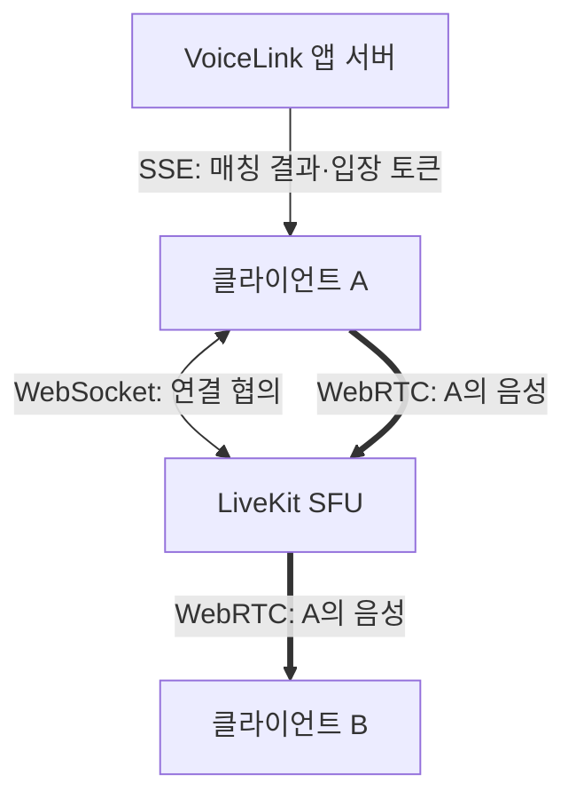

브라우저에서 LiveKit WebSocket이 열렸는데 상대 목소리는 안 들린다고 하자. 설명용 상황이다. 연결 하나가 성공했으니 통신은 끝났다고 생각하기 쉽지만, **연결을 협의하는 길과 목소리가 오가는 길은 다르다.**

VoiceLink의 Flutter 클라이언트는 `livekit_client` 2.5.4를 쓴다. 현재 코드를 따라 매칭 결과를 받는 것부터 상대 음성을 듣기까지 길을 나눠 보자.

## 매칭 결과에는 목소리가 들어 있지 않다

앱의 API와 SSE는 매칭 요청·결과, 통화 종료·연장 같은 업무 정보를 주고받는다. 매칭 결과에는 세션 ID, LiveKit 접속 주소와 입장 토큰이 담긴다. 서버의 `LiveKitTokenService`는 그 세션의 방에 들어가 트랙을 발행하고 구독할 권한을 토큰에 넣는다. 입장권을 받았다고 대화까지 나눈 것은 아니다.

그다음 SDK가 LiveKit에 연결한다. LiveKit의 signaling은 WebSocket으로 방 정보와 미디어 연결 협상 정보를 교환한다. 음성 트랙은 별도의 WebRTC 연결로 LiveKit SFU에 보내고, SFU가 구독한 상대에게 전달한다. 앱의 SSE가 이 signaling을 대신하지 않는다.

아래는 역할을 구분한 그림이다. 음성은 A가 말하는 방향만 그렸고, B도 같은 방식으로 LiveKit에 연결한다. TURN을 거치는 중계 구간은 생략했다.

**두 사람의 통화여도 A와 B가 직접 음성을 교환하는 P2P 그림은 아니다.** VoiceLink에서는 각 클라이언트가 LiveKit SFU와 미디어를 주고받는다. 저장소의 `livekit.yaml`도 서버 포트와 `rtc`의 TCP·UDP 포트 설정을 나눈다.

## ‘연결됨’ 다음에 확인할 것

`LiveKitService.connect()`는 `room.connect()`를 기다린 뒤 마이크 트랙을 만들고 `publishAudioTrack()`을 호출한다. 이후 오디오 재생을 시도한다. WebSocket이 열렸다는 관찰 하나에는 이 뒤의 과정이 담기지 않는다.

재생 처리에는 눈여겨볼 부분이 있다. `_tryStartAudio()`는 `room.startAudio()`가 실패하면 예외를 밖으로 던지지 않고 `false`를 돌려준다. 그런데 호출하는 쪽은 그 반환값을 분기하지 않고 다음 `ready` 단계로 간다. **코드의 준비 완료 표시와 실제 재생 성공도 같은 뜻이 아니었다.**

앞의 무음 상황에 적용하면 확인할 곳이 달라진다.

- 마이크 트랙 발행 전이라면 권한과 트랙 생성부터 본다. 보낸 적이 없는 소리를 중계 서버에서 찾을 수는 없다.
- 발행·구독은 됐는데 수신 패킷이 늘지 않는다면 선택된 미디어 경로를 살핀다. 이때 [외부 TURN 구성](https://so-dak.com/livekit-external-turn/)도 확인 대상이 된다.
- 수신 패킷은 늘지만 무음이라면 오디오 재생 상태와 음량, 출력 장치를 이어서 본다. 패킷 도착만으로 소리가 들렸다고 결론 내리지 않는다.

코드와 프로토콜에서 정리한 점검 순서이며 실제 장애 재현 결과는 아니다. [마이크 권한과 연결 수명](https://so-dak.com/webrtc-livekit-%ec%97%b0%eb%8f%99-%ed%9a%8c%ea%b3%a0-%ea%b7%b8%eb%83%a5-%ec%98%a4%ed%94%88%ec%86%8c%ec%8a%a4-%ec%84%9c%eb%b2%84-%eb%9d%84%ec%9a%b0%eb%a9%b4-%eb%90%98%eb%8a%94-%ea%b1%b0-%ec%95%84/)을 따로 보는 것도, ‘연결됨’ 한 단어에 가려진 단계를 나누기 위해서다.

## 참고 자료

- [LiveKit Client Protocol: WebSocket과 WebRTC 연결](https://docs.livekit.io/reference/internals/client-protocol/)
- [LiveKit SFU: 발행자에서 구독자로 미디어 전달](https://docs.livekit.io/reference/internals/livekit-sfu/)

근거: 2026-10-15 VoiceLink `37109d5`의 `MatchResponseFactory`, `LiveKitTokenService`, Flutter `match_api.dart`·`livekit_service.dart`, 연결 테스트, `livekit.yaml`과 통화 수명주기 문서를 대조했다. 방과 마이크 트랙을 바꿔 넣는 대역 테스트를 두 기기의 실제 음성 수신 근거로 쓰지 않았다.
